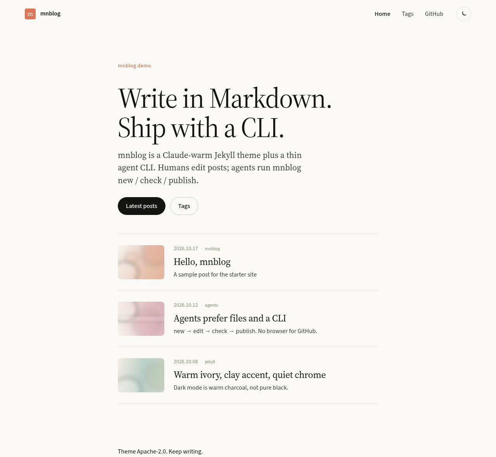
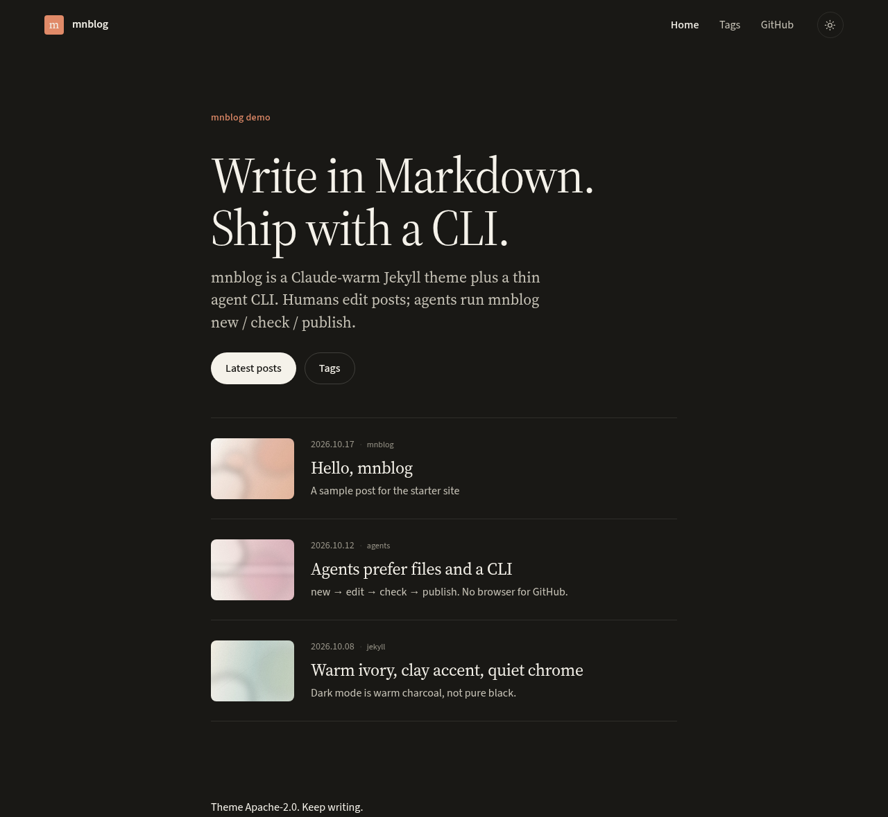
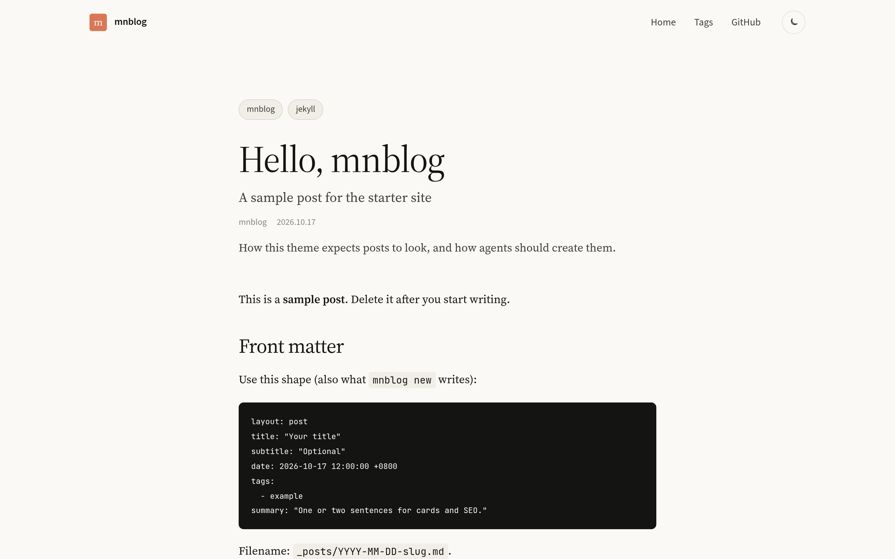
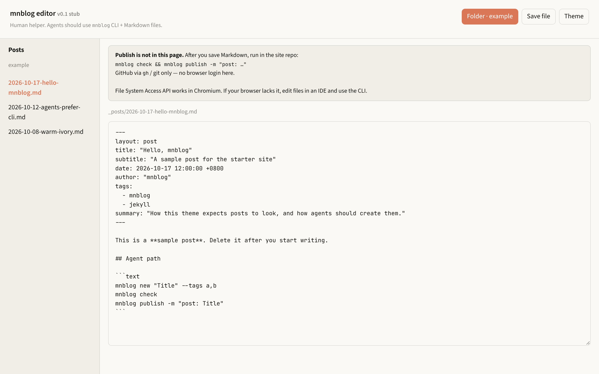

<h1 align="center">mnblog</h1>

<p align="center">
  <strong>A warm editorial Jekyll theme with a thin CLI meant for people and coding agents.</strong>
</p>

<p align="center">
  Ivory canvas, clay accent, Source Serif + Source Sans, large type, quiet chrome. Dark mode is warm charcoal, not pure black. The visual layer is inspired by Claude.ai’s product site; this repo is independent and not affiliated with Anthropic.
</p>

<p align="center">
  <a href="https://github.com/miniLV/mnblog/releases/latest">Latest Release</a> ·
  <a href="https://github.com/miniLV/mnblog">GitHub</a> ·
  <a href="./README.md">简体中文</a> · <strong>English</strong>
</p>

<p align="center">
  <code>./bin/mnblog init ../my-blog</code>
</p>

<p align="center">
  Markdown in <code>_posts/</code> · agents on the CLI · native GitHub Pages builds
</p>

<p align="center">
  <a href="https://github.com/miniLV/mnblog/releases">
    
  </a>
  <a href="./LICENSE">
    
  </a>
  
  
</p>

<p align="center">
  
</p>

<p align="center">
  
</p>

<p align="center">
  
</p>

<p align="center">
  
</p>

Extracted from the theme layer of [miniLV.github.io](https://github.com/miniLV/miniLV.github.io). Content, personal images, and site identity stay in your own blog repo.

---

## What you get

- Markdown posts in `_posts/` (same habit as a normal Jekyll blog)
- Layouts for home, post, tags, and 404 — Sass only, no Grunt / webpack / Bootstrap
- GitHub Pages–friendly (`github-pages` gem / `remote_theme`)
- Optional front matter: `summary`, `subtitle`, `cover_image` / `header-img`
- Light / dark toggle that remembers the choice (falls back to system preference)
- **`mnblog` CLI** for agents: `init` → `new` → `check` → `publish`
- A small **local editor** stub for humans (optional; publish still goes through the CLI)

---

## Three steps

### 1. Create a site

```bash
git clone https://github.com/miniLV/mnblog.git
cd mnblog
./bin/mnblog init ../my-blog
cd ../my-blog
```

`init` copies the example site and **vendors** the theme (`_layouts`, `_includes`, `_sass`, `assets`, …) so local preview works without waiting on GitHub.

Edit `_config.yml`: `title`, `url`, `nav_items`, hero copy, social links.

### 2. Preview locally

Needs Ruby + Bundler:

```bash
bundle install
bundle exec jekyll serve
# or: mnblog serve
```

Open `http://127.0.0.1:4000`.

### 3. Write and publish

**Human or agent — same files:**

```bash
mnblog new "Your title" --tags jekyll,notes
# edit the file under _posts/
mnblog check
mnblog publish -m "post: Your title"
```

Push to a GitHub Pages repo (often `<user>.github.io`). Pages builds with Jekyll; no Actions workflow is required for the default path.

GitHub access for agents: **`gh` / git / API only** — do not drive github.com in a browser.

---

## Write a post

`mnblog new` creates this shape. You can also hand-write `_posts/YYYY-MM-DD-slug.md`:

```md
---
layout: post
title: "Your title"
subtitle: "Optional subtitle"
date: 2026-10-17 12:00:00 +0800
author: "Your name"
tags:
  - Jekyll
  - Notes
summary: "Optional custom summary for cards."
# cover_image: /assets/img/covers/cover-clay-dawn.jpg  # optional; file must exist
---

Your content here.
```

Notes:

- Filename under `_posts/` must be `YYYY-MM-DD-slug.md`.
- `summary` is optional. Cards fall back to `subtitle` or an excerpt.
- `cover_image` / `header-img` are optional. Posts render fine without images — **do not invent image URLs**.
- Drafts: `mnblog new "Title" --draft` → `_drafts/`.

Full agent conventions: [AGENTS.md](./AGENTS.md) · skill pack: [skills/mnblog/SKILL.md](./skills/mnblog/SKILL.md)

---

## Agent path (preferred)

Agents should stay on the filesystem and CLI:

```text
mnblog new "Title" --tags a,b
→ edit _posts/YYYY-MM-DD-slug.md
→ mnblog check
→ mnblog publish -m "post: Title"
```

| Command | What it does |
|---------|----------------|
| `mnblog init [dir]` | Starter site + vendored theme |
| `mnblog new "title"` | New post with front matter |
| `mnblog check [path]` | Validate front matter + date filename |
| `mnblog publish` | `git add` / `commit` / `push` (`--dry-run` supported) |
| `mnblog serve` | `bundle exec jekyll serve` when Bundler is available |
| `mnblog editor` | Serve `editor/` on `http://127.0.0.1:4173/` |

Zero npm dependencies for the CLI (Node ≥ 18). Optional: `package.json` exposes the `mnblog` bin.

---

## Use as `remote_theme`

If you already have a Jekyll site and only want the look:

```yaml
remote_theme: miniLV/mnblog
plugins:
  - jekyll-remote-theme
  - jekyll-paginate
  - jekyll-sitemap

theme_stylesheet: "/assets/css/style.css"
theme_script: "/assets/js/site.js"
favicon: "/assets/favicon.svg"
```

Keep your own `_posts`, `index.html`, `tags.html`, and identity fields. When `remote_theme` is active, you can drop local copies of `_layouts` / `_includes` / `_sass` / `assets`.

There is also an `mnblog.gemspec` for the classic gem-theme layout if you prefer that over remote.

---

## Customize the site

Most site-level copy lives in `_config.yml` (same idea as the source blog):

| Key | Role |
|-----|------|
| `title` · `SEOTitle` · `description` | Identity |
| `brand_mark` | Letter in the nav mark |
| `default_eyebrow` | Small label under the title |
| `hero_title` · `hero_description` · `hero_*_cta` | Home hero |
| `nav_items` · `social_links` · `footer_note` | Chrome |
| `theme_stylesheet` · `theme_script` · `favicon` | Asset paths |
| `timezone` | Default examples use `Asia/Shanghai` |

Theme CSS tokens live in `_sass/_tokens.scss` (light ivory / dark charcoal). Change those only when you are intentionally forking the look.

---

## Local editor (optional)

```bash
mnblog editor
# → http://127.0.0.1:4173/
```

v0.1 stub: in Chromium, open a site folder, edit `_posts/*.md`, save via the File System Access API. **Publish is not in the page** — run `mnblog publish` (or git) afterward. Agents should not depend on this UI.

---

## Fonts

Google Fonts are linked for Source Sans 3, Source Serif 4, and JetBrains Mono. Without network fonts, the stack falls back to Helvetica / Georgia / system mono. No local font install is required.

---

## Repository layout

```text
_layouts/  _includes/  _sass/   theme
assets/                     CSS entry, JS, favicon
css/  js/                   same assets mirrored for copy-paste sites
bin/mnblog                  agent CLI
example/                    demo site + 3 sample posts + parchment covers
editor/                     human stub
docs/assets/readme/         README screenshots
AGENTS.md  skills/          agent docs
```

**Not** included: personal posts, personal `img/`, submodules, or migrating [miniLV.github.io](https://github.com/miniLV/miniLV.github.io). That stay-on-the-blog migration is a follow-up.

---

## Status

**v0.1.2** — sample post covers are soft parchment washes; no-cover card fallbacks are softer. Theme + CLI + zh/en README screenshots still the baseline.

## License

[Apache License 2.0](./LICENSE)
