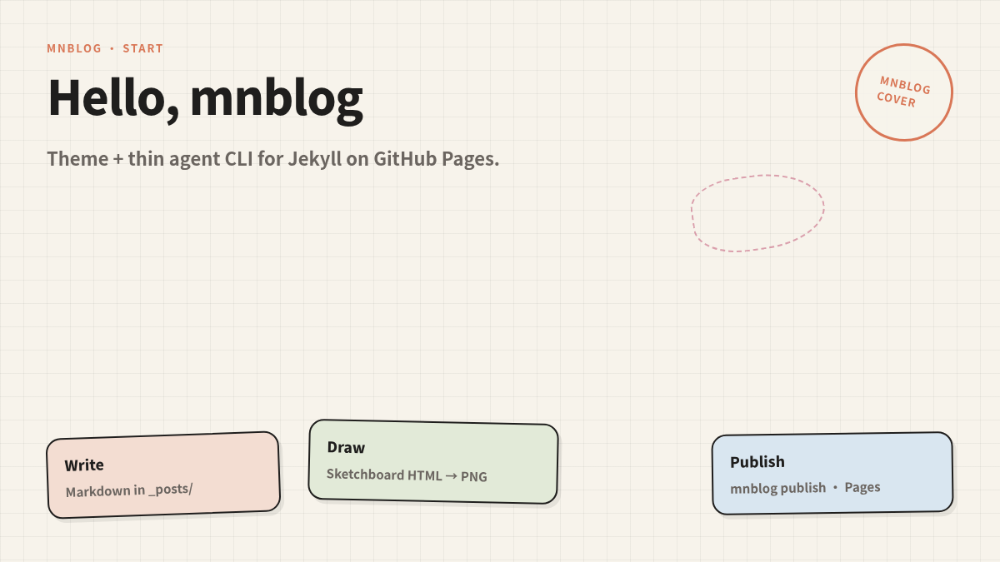

<h1 align="center">mnblog</h1>

<p align="center">
  <strong>偏编辑气质的 Jekyll 主题，加上一层给人和 coding agent 用的 CLI。</strong>
</p>

<p align="center">
  暖象牙底 · clay 强调色 · Source Serif / Source Sans<br />
  Markdown 进 <code>_posts/</code> · agent 走 CLI · sketchboard 出封面
</p>

<p align="center">
  <a href="https://minilv.github.io/mnblog/">官网</a> ·
  <a href="https://github.com/miniLV/mnblog/releases/latest">Latest Release</a> ·
  <a href="https://github.com/miniLV/mnblog">GitHub</a> ·
  <strong>简体中文</strong> · <a href="./README.en.md">English</a>
</p>

<p align="center">
  <code>./bin/mnblog init ../my-blog</code>
</p>

<p align="center">
  <a href="https://github.com/miniLV/mnblog/releases">
    
  </a>
  <a href="./LICENSE">
    
  </a>
  
  
</p>

<p align="center">
  
</p>

<p align="center">
  
</p>

主题从 [miniLV.github.io](https://github.com/miniLV/miniLV.github.io) 的主题层抽出。观感受 Claude.ai 产品站启发；本仓库与 Anthropic 无官方关系。文章与站点身份留在你自己的博客仓。

---

## 你会得到什么

- 继续在 `_posts/` 里写 Markdown；首页 / 文章 / 标签 / 404，只用 Jekyll Sass
- 兼容 GitHub Pages（`github-pages` gem / `remote_theme`）
- 深浅色切换（暖褐黑，不是纯黑）
- **`mnblog` CLI**：`init` → `new` → `check` → `publish`，以及 `ask` / `desk`
- **sketchboard 配图**：`mnblog cover` / `mnblog draw`
- 本地 **Desk**（`mnblog desk --ui`）：文章列表 + Markdown + 本机 agent 一次性会话

---

## 三步上手

```bash
git clone https://github.com/miniLV/mnblog.git
cd mnblog
./bin/mnblog init ../my-blog
cd ../my-blog

# 需要 Ruby + Bundler
bundle install && bundle exec jekyll serve   # 或 mnblog serve
# → http://127.0.0.1:4000

mnblog new "文章标题" --tags jekyll,notes
mnblog check
mnblog publish -m "post: 文章标题"
```

`init` 会拷贝 example，并把主题 **vendoring** 进新站点。改 `_config.yml` 里的 `title`、`url`、导航与首页文案即可。

推到 GitHub Pages 仓库后，Jekyll 自动构建。Agent 访问 GitHub：**只用 `gh` / git / API**，不要用浏览器自动化 github.com。

---

## 新建文章

```md
---
layout: post
title: "文章标题"
subtitle: "可选副标题"
date: 2026-10-17 12:00:00 +0800
author: "你的名字"
tags:
  - Jekyll
summary: "可选卡片摘要"
# cover_image: /assets/img/covers/cover-hello-mnblog.png
---
```

- 文件名：`_posts/YYYY-MM-DD-slug.md`
- 没有封面也能正常渲染 —— **不要编造图片 URL**
- 草稿：`mnblog new "标题" --draft`

约定：[AGENTS.md](./AGENTS.md) · skill：[skills/mnblog/SKILL.md](./skills/mnblog/SKILL.md)

---

## Agent 主路径

```text
mnblog new "标题" --tags a,b
→ 改 _posts/YYYY-MM-DD-slug.md
→ mnblog check
→ mnblog publish -m "post: 标题"
```

```bash
mnblog desk                 # 交互：拉起本机 claude / codex
mnblog desk --ui            # 本地 Desk（http://127.0.0.1:4177/）
mnblog ask "写一篇关于 X 的草稿"
mnblog cover "标题"         # sketchboard 封面
mnblog draw "流程" --kind flow
```

| 命令 | 作用 |
|------|------|
| `init` / `new` / `check` / `publish` / `serve` | 建站、写文、校验、推送、预览 |
| `desk` / `desk --ui` / `ui` / `ask` | 本机 agent 与 Desk |
| `cover` / `draw` | sketchboard 封面 / 文内图 |

**不向 mnblog 配置云端 API key** —— 沿用本机已登录的 Claude Code / Codex。Desk 每一发都是新的 CLI 进程（one-shot）；渲 PNG 需要本机 Chrome。

---

## 配图（sketchboard）

```bash
mnblog cover "文章标题"              # → assets/img/covers/<slug>.png
mnblog draw "发布闭环" --kind flow   # architecture | flow | flywheel
mnblog new "标题" --with-cover
```

本仓已精简 vendored [sketchboard-diagram](https://github.com/miniLV/sketchboard-diagram)。没有 Chrome 时仍会写出 `_diagrams/*.html` 与 agent prompt。

---

## 本地 Desk

```bash
mnblog desk --ui   # 或 mnblog ui
```

三栏：左文章列表，中 Markdown（Ctrl/Cmd+S 保存），右本机 agent 流式面板。只绑 `127.0.0.1`，零 npm 依赖。

---

## 用作 `remote_theme`

```yaml
remote_theme: miniLV/mnblog
plugins:
  - jekyll-remote-theme
  - jekyll-paginate
  - jekyll-sitemap
theme_stylesheet: "/assets/css/style.css"
theme_script: "/assets/js/site.js"
favicon: "/assets/favicon.svg"
```

也提供 `mnblog.gemspec`。

---

## 站点配置

| 字段 | 作用 |
|------|------|
| `title` · `SEOTitle` · `description` | 身份 |
| `brand_mark` · `default_eyebrow` | 顶栏与小标签 |
| `hero_*` · `nav_items` · `social_links` | 首页与导航 |
| `theme_stylesheet` · `theme_script` · `favicon` | 资源路径 |
| `timezone` | 示例默认 `Asia/Shanghai` |

配色 token：`_sass/_tokens.scss`。

---

## 仓库结构

```text
_layouts/  _includes/  _sass/   主题
assets/  css/  js/              样式与脚本
bin/mnblog                      CLI（ask / desk / cover / draw …）
desk/                           本地 Desk
example/                        演示站 + sketchboard 封面
docs/                           官网宣传页 + README 截图
AGENTS.md  skills/              agent 文档 + skill
```

**不包含**：个人文章、把 miniLV.github.io 迁到本主题（后续工作）。

---

## 状态

**v0.4.0+** — sketchboard 封面 / 文内图（`cover` / `draw`）· 本地 Desk · agent CLI（`ask` / `desk`）。Apache-2.0。

## 许可

[Apache License 2.0](./LICENSE)
