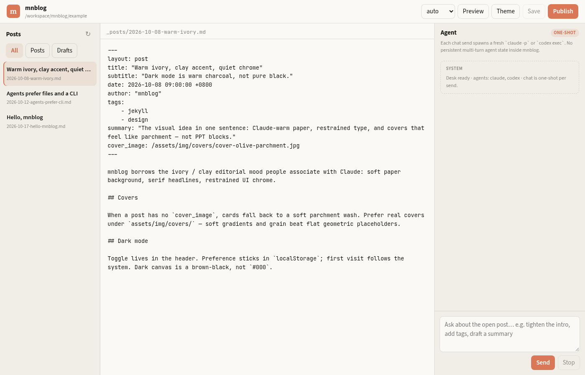
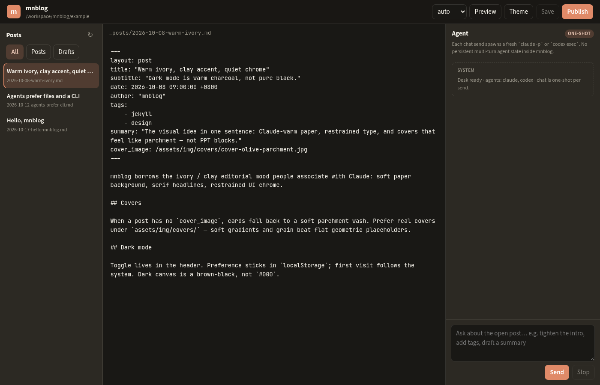

<h1 align="center">mnblog</h1>

<p align="center">
  <strong>偏编辑气质的 Jekyll 主题，加上一层给人和编程 agent 用的 CLI。</strong>
</p>

<p align="center">
  浅色是暖象牙底 + clay 强调色，Source Serif / Source Sans，字号偏大、留白偏多；深色是暖褐黑，不是纯黑。观感受 Claude.ai 产品站启发；本仓库与 Anthropic 无官方关系。
</p>

<p align="center">
  <a href="https://github.com/miniLV/mnblog/releases/latest">Latest Release</a> ·
  <a href="https://github.com/miniLV/mnblog">GitHub</a> ·
  <strong>简体中文</strong> · <a href="./README.en.md">English</a>
</p>

<p align="center">
  <code>./bin/mnblog init ../my-blog</code>
</p>

<p align="center">
  Markdown 进 <code>_posts/</code> · agent 走 CLI · GitHub Pages 原生构建
</p>

<p align="center">
  <a href="https://github.com/miniLV/mnblog/releases">
    
  </a>
  <a href="./LICENSE">
    
  </a>
  
  
</p>

<p align="center">
  
</p>

<p align="center">
  
</p>

<p align="center">
  
</p>

<p align="center">
  
</p>

<p align="center">
  
</p>

<p align="center">
  
</p>

主题从 [miniLV.github.io](https://github.com/miniLV/miniLV.github.io) 的主题层抽出。文章、个人配图、站点身份留在你自己的博客仓。

---

## 你会得到什么

- 继续在 `_posts/` 里写 Markdown
- 首页、文章页、标签页、404 —— 只用 Jekyll Sass，不依赖 Grunt / webpack / Bootstrap
- 兼容 GitHub Pages（`github-pages` gem / `remote_theme`）
- 可选 front matter：`summary`、`subtitle`、`cover_image` / `header-img`
- 深浅色切换，会记住选择（否则跟系统）
- **`mnblog` CLI**：`init` → `new` → `check` → `publish`，以及 `ask` / `desk`（拉起本机 Claude Code / Codex）
- **sketchboard 配图**：`mnblog cover` / `mnblog draw`，减轻作者出图负担
- 本地 **Desk**（`mnblog desk --ui` / `mnblog ui`）：左栏文章、中间 Markdown、右栏本机 agent 一次性会话

---

## 三步上手

### 1. 建站

```bash
git clone https://github.com/miniLV/mnblog.git
cd mnblog
./bin/mnblog init ../my-blog
cd ../my-blog
```

`init` 会拷贝 example，并把主题目录 **vendoring** 进新站点（`_layouts`、`_includes`、`_sass`、`assets` 等），本地预览不必等 GitHub 拉远程主题。

改 `_config.yml`：`title`、`url`、`nav_items`、首页文案、社交链接。

### 2. 本地预览

需要 Ruby + Bundler：

```bash
bundle install
bundle exec jekyll serve
# 或：mnblog serve
```

打开 `http://127.0.0.1:4000`。

### 3. 写文章并发布

人和 agent 用同一套文件：

```bash
mnblog new "文章标题" --tags jekyll,notes
# 编辑 _posts/ 下的文件
mnblog check
mnblog publish -m "post: 文章标题"
```

推到 GitHub Pages 仓库（常见是 `<user>.github.io`）。Pages 用 Jekyll 自动构建，默认链路不需要额外 Actions。

Agent 访问 GitHub：**只用 `gh` / git / API**，不要用浏览器自动化 github.com。

---

## 新建文章

`mnblog new` 会写出下面这种 front matter；也可以手写 `_posts/YYYY-MM-DD-slug.md`：

```md
---
layout: post
title: "文章标题"
subtitle: "可选副标题"
date: 2026-10-17 12:00:00 +0800
author: "你的名字"
tags:
  - Jekyll
  - Notes
summary: "可选，自定义卡片摘要。"
# cover_image: /assets/img/covers/cover-hello-mnblog.png  # mnblog cover "…"
---

正文写在这里。
```

说明：

- `_posts/` 下文件名必须是 `YYYY-MM-DD-slug.md`
- `summary` 可选；不填时卡片会回退到 `subtitle` 或正文摘要
- `cover_image` / `header-img` 可选；没有图也能正常渲染 —— **不要编造图片 URL**
- 草稿：`mnblog new "标题" --draft` → `_drafts/`

更完整的 agent 约定：[AGENTS.md](./AGENTS.md) · skill：[skills/mnblog/SKILL.md](./skills/mnblog/SKILL.md)

---

## Agent 主路径（推荐）

Agent 应走文件系统和 CLI，而不是网页：

```text
mnblog new "标题" --tags a,b
→ 改 _posts/YYYY-MM-DD-slug.md
→ mnblog check
→ mnblog publish -m "post: 标题"
```

需要本机 Claude Code / Codex 或 Desk 时：

```bash
cd my-blog
mnblog desk                      # 交互：在站点根目录拉起 claude（或 codex）
mnblog desk --ui                 # 本地 Desk 网页（默认 http://127.0.0.1:4177/）
mnblog ui                        # 同上
mnblog ask "写一篇关于 X 的草稿"  # 一次性：claude -p … / 或 codex exec …
mnblog desk --agent codex        # 强制 Codex
mnblog ask --agent auto "…" -- --output-format json   # -- 之后参数原样传给 agent CLI
```

| 命令 | 作用 |
|------|------|
| `mnblog init [dir]` | 示例站 + 本地主题 + AGENTS/skill |
| `mnblog new "title"` | 带 front matter 的新文章 |
| `mnblog check [path]` | 校验 front matter 与日期文件名 |
| `mnblog publish` | `git add` / `commit` / `push`（支持 `--dry-run`） |
| `mnblog serve` | 有 Bundler 时跑 `jekyll serve` |
| `mnblog editor` | 等同 `desk --ui`（旧名） |
| `mnblog desk` | 在站点根目录开交互式 `claude` / `codex` |
| `mnblog desk --ui` / `mnblog ui` | 本地 Desk：文章列表 + 编辑器 + agent 面板 |
| `mnblog ask "…"` | 一次性提问；无 prompt 时退回 `desk` |
| `mnblog cover "…"` / `mnblog draw "…"` | sketchboard 封面 / 文内图（HTML→PNG） |

`ask` / `desk` / `ui` 会：定位最近的 `_config.yml` + `_posts/`；若缺 `AGENTS.md` / `skills/mnblog/` 则从本包拷贝；检测 PATH 上的 `claude` / `codex`（`--agent auto` 两者都有时优先 Claude）。**不向 mnblog 配置云端 API key**——沿用你本机已登录的 Claude Code / Codex。

诚实边界：Codex 一次性入口是 `codex exec`（不是 `-p`）；两边都没装会报清晰错误；**Desk 聊天每一发都是新的 CLI 进程**（one-shot），没有内建多轮会话状态——历史只作为下一次 prompt 的上下文拼接。

CLI 无 npm 依赖（Node ≥ 18）。`package.json` 里挂了 `mnblog` bin，可按需安装。


---

## 配图 / Images（sketchboard）

封面和文内架构图走 [sketchboard-diagram](https://github.com/miniLV/sketchboard-diagram)（本仓已精简 vendored 到 `skills/sketchboard-diagram/`）。**不要编造图床 / Unsplash URL。**

### 三步

```bash
# 1) 封面 → assets/img/covers/<slug>.png + 打印 front matter
mnblog cover "文章标题"

# 2) 文内图（architecture | flow | flywheel）
mnblog draw "发布闭环" --kind flow

# 3) 把路径写进文章
# cover_image: /assets/img/covers/….png
# 或 
```

`mnblog new "标题" --with-cover` 会先 stub `cover_image`，再提醒你跑 `mnblog cover`。

有本机 Chrome/Chromium 时 CLI 会直接 HTML→PNG；没有时仍会写出 `_diagrams/*.html` 和完整 agent prompt，交给 `mnblog ask` / Desk 预设「Generate cover / diagram」。也可：

```bash
npx skills add https://github.com/miniLV/sketchboard-diagram
```

示例站首页三张封面和一篇文内流程图，已是 sketchboard 渲染的 PNG（源 HTML 在 `example/_diagrams/`）。


---

## 用作 `remote_theme`

已有 Jekyll 站、只想换皮时：

```yaml
remote_theme: miniLV/mnblog
plugins:
  - jekyll-remote-theme
  - jekyll-paginate
  - jekyll-sitemap

theme_stylesheet: "/assets/css/style.css"
theme_script: "/assets/js/site.js"
favicon: "/assets/favicon.svg"
```

自己的 `_posts`、`index.html`、`tags.html` 和身份字段留在站点仓。启用 `remote_theme` 后，本地的 `_layouts` / `_includes` / `_sass` / `assets` 可以删掉。

也提供了 `mnblog.gemspec`，若你更习惯 gem theme 也可以。

---

## 站点配置

和源站一样，站点级文案主要在 `_config.yml`：

| 字段 | 作用 |
|------|------|
| `title` · `SEOTitle` · `description` | 身份 |
| `brand_mark` | 顶栏字母标 |
| `default_eyebrow` | 标题下的小标签 |
| `hero_title` · `hero_description` · `hero_*_cta` | 首页 |
| `nav_items` · `social_links` · `footer_note` | 导航与页脚 |
| `theme_stylesheet` · `theme_script` · `favicon` | 资源路径 |
| `timezone` | 示例默认 `Asia/Shanghai` |

配色 token 在 `_sass/_tokens.scss`。只有打算改皮肤时才动它们。

---

## 本地 Desk（人用）

```bash
cd my-blog
mnblog desk --ui
# 或：mnblog ui
# → http://127.0.0.1:4177/
```

三栏：左 `_posts/` / `_drafts/`，中 Markdown（Ctrl/Cmd+S 保存到磁盘），右 agent 面板（流式输出本机 `claude -p` / `codex exec`）。顶栏可选 agent、Publish（确认后跑 `mnblog publish`）、简易 Preview。完整 Jekyll 预览另开：`mnblog serve`。

- 只绑 `127.0.0.1`，零 npm 依赖
- **不存**云端 API key，不做 GitHub OAuth
- Agent 主路径仍是 CLI + 文件；Desk 给人点

`mnblog editor` 现为 Desk 别名；旧 stub 页仅作提示。

---

## 字体

默认通过 Google Fonts 加载 Source Sans 3、Source Serif 4、JetBrains Mono；没网时回退到系统字体。不必本机安装字体文件。

---

## 仓库结构

```text
_layouts/  _includes/  _sass/   主题
assets/                     样式入口、JS、favicon
css/  js/                   同套资源，方便整仓拷贝
bin/mnblog                  agent CLI（含 ask / desk / ui）
desk/                       本地 Desk 服务端 + UI
example/                    演示站 + 3 篇样例 + 羊皮纸封面
editor/                     旧 stub（指向 Desk）
docs/assets/readme/         README 截图
AGENTS.md  skills/          agent 文档 + skill
```

**不包含**：个人文章、个人 `img/`、子模块，也不包含把 [miniLV.github.io](https://github.com/miniLV/miniLV.github.io) 迁到消费本主题 —— 那是后续工作。

---

## 状态

**v0.3.0** — 本地 Desk（`mnblog desk --ui` / `mnblog ui`）：文章列表 + Markdown 编辑保存 + 本机 agent one-shot 流式面板 + Publish。v0.2 的 TTY `ask` / `desk` 仍可用。

## 许可

[Apache License 2.0](./LICENSE)
